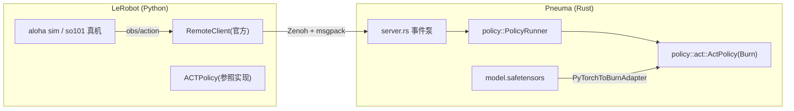

# DESIGN — 开发期快照（可推翻）

本文件记录 Pneuma 当前的边界与路线选择，供讨论先改文档、再改代码。
开发阶段一切可推翻：讨论改了边界，先改本文件。

## 边界

- **Pneuma（本仓，Rust）**：remote-inference v1 服务端 + Burn 策略运行时。拥有协议、合约、权重加载、推理执行。
- **LeRobot（外部，Python）**：仿真环境、遥操作、数据集、训练、rollout 客户端。Pneuma 不复制它，只对接。
- 概念对齐：一个策略 = 一个 `policy::PolicyRunner` 实现；一个部署 = 一套合约 profile；协议字段、semantics、类型名一处一名，不留第二套说法。

## 会话调度

`server.rs` 的 pump 独占会话状态、准入、控制回复和推理结果发布。同步 `PolicyRunner::predict` 在至多一个 blocking worker 中执行；reset/close/reopen 可以推进，但旧 worker 实际退出前仍占推理名额，不把 abort 当作同步推理取消。completion 回到 pump 后比对当前 session/generation，失效的成功和错误结果均丢弃。

回调入口使用容量 32 的有界通道和非阻塞发送。observation 在复制 payload 前取得全实例唯一名额，该名额跨排队、推理和 completion 处理存活，不另设等待观测队列。忙时最多保留一个额外 payload 用于发布关联的 Busy；此回复名额或入口已满时直接丢弃超量消息，不生成额外任务/overflow 事件。language 同样只有一个待处理 payload 名额；入口已满的 query 由客户端超时处理。控制不会等待 predict，有限的入口积压不会保留无限图像。

ACTION 的 `server_durations.queue` 从回调接收时刻计到 worker 内 predict 开始，包含调度等待；`worker` 仅计 predict 的实际执行时间，排除发布。慢策略回归通过进入/释放握手验证控制推进、过载和旧结果隔离，超时仅作为死锁保护。

## 运行时决策：Burn 单路径

1. **实现**：策略用 Burn 手写模块，结构体与字段名对齐 PyTorch 属性名（`ACTPolicy`、`resnet`、`encoder`…），使权重键无需批量重映射。不用 `burn-onnx`，不用 `ort`——lerobot checkpoint 本身就是 `model.safetensors` + `config.json`，ONNX 中介只会引入算子覆盖与动态 shape 两类无谓风险。
2. **版本与 features**：Cargo 版本要求为 `0.22.0-pre.3`，当前 lockfile 解析为 Burn `0.22.1`（0.22 与 0.21 API 断裂：`Tensor::<D>` 不再泛型于 Backend）。关闭 `burn`、`burn-store` 默认 features，分别显式启用 `std/flex/metal` 和 `std/safetensors/memmap`，保留推理与 safetensors 适配，移除未使用的 optimizer/autodiff 和 PyTorch archive reader 依赖路径。MSRV 1.95，本机 nightly 1.101 满足。
3. **后端**：`model.device=auto|flex|metal` 选择设备；`auto` 使用 `Device::default()`（启用后端 GPU 优先于 CPU，遵循 Burn 的 `BURN_DEVICE` 默认设备机制），显式 `flex`/`metal` 调用对应构造器。编译期同时启 `flex`（纯 Rust CPU，数值可复现）与 `metal`（Apple GPU）。`load` 末尾按 `execution.warmup_calls` 做零观测预热：metal 首推理的内核 JIT（秒级）挪进启动期，兼作权重/算子的加载自检。dtype 固定 f32。
4. **权重**：`burn-store` 的 `SafetensorsStore + PyTorchToBurnAdapter`；键对不上时按键 dump 对照修正，不做名称猜测。
5. **推理形态**：首版只做 plain chunk——观测进、`[chunk_size, action_dim]` 出，配合客户端 `chunk_merge=append`。temporal ensembling、RTC/blending、aligned merge 不在首版，入口处显式拒绝（与骨架既有原则一致）。

## 合约 profile

部署合约写在 TOML 文件中，字段分组沿用 LeRobot（`model`、`execution`、`zenoh`、`features`、`action_feature`）。`--config server.toml` 指定文件，CLI 只提供常见启动调整：checkpoint、设备、策略、动作频率、执行步数、预热次数及网络拓扑；schema、semantics 和完整部署信息只在 TOML 中维护。so101 / aloha_sim 是 `examples/` 下的部署示例，不在源码中维护另一套 profile。

`cli.rs` 用 clap derive 的 `ModelArgs`、`ExecutionArgs`、`NetworkArgs` 组织类型化参数，采用 `--device`、`--action-fps` 等长选项；仅将显式传入的值直接赋给 `ServerConfig` 字段，不经过 TOML 序列化和点号路径解析。字符串按 argv 原样接收；`--listen`、`--connect` 可重复指定地址，`--clear-listen`、`--clear-connect` 显式清空对应列表（与同一列表的地址参数互斥）。`ServerConfig::load` 只读取和反序列化 TOML；应用 CLI 覆盖后，由 `Server::new` 校验最终配置，再加载策略。`main` 通过 clap 处理帮助、版本和参数诊断，配置模块不退出进程。旧点号 CLI 参数移除，TOML 格式保持不变。

部署配置负责通用 schema、semantics、执行和网络约束；ACT 支持的固定 state/image/action 特征由 ACT 模块的纯校验函数维护，策略构建在读取 checkpoint 和预热之前校验，并在最终通告合约上复用。checkpoint 数值不变量在构造模块前校验，归一化缓冲在预热前校验；不合法输入返回启动错误。

`model.policy=echo|act|smolvla` 选择实现，`model.repo_or_path` 为本地 checkpoint 目录；`model.device=auto|flex|metal` 显式选择 Burn 后端。ACT 与 SmolVLA 的预测/执行步数默认取 checkpoint，`execution.n_action_steps` 可限制执行片段；echo 的步数在示例中显式声明。配置中不支持的字段或取值在启动时拒绝。

| profile | state | 相机 | action | action_interval | semantics |
|---|---|---|---|---|---|
| `so101.toml`（echo 冒烟） | 6×f32 | front 480×640×3 u8 | 6×f32 | 1/30 | `so101-degrees-gripper-percent-v1` |
| `aloha_sim.toml`（仿真主线） | 14×f32 | top 480×640×3 u8 | 14×f32 | 1/50 | `aloha-sim-14d-v1` |

`aloha_sim` 的 `prediction_steps`/`execution_steps` 从 checkpoint `config.json` 的 `chunk_size`/`n_action_steps` 读取，不二次发明。图像 resize/归一化等预处理归 Burn 侧（对照 lerobot processor 管线实现），Python 端只发环境原图。

## 首个策略：官方 ACT（aloha 仿真）

权重取官方 `lerobot/act_aloha_sim_transfer_cube_human`（官方 namespace 唯一的仿真 ACT checkpoint；pusht 官方无 ACT）。移植面：ResNet18（conv/BN/残差/pool）+ Transformer encoder-decoder + 位置编码 + action/state 投影，`burn::nn` 构件齐备。

## SmolVLA

SmolVLA 沿用 `PolicyRunner` 与 Burn 单路径，直接加载 LeRobot 本地 checkpoint。新增 SmolVLM2 视觉/文本编码与动作专家，使用 flow matching 生成动作块。`OBSERVATION.body.task` 随请求传入策略，作为语言条件；`capabilities.language` 仍表示独立的语言生成能力，不因支持任务文本而开启。请求不在策略内保留任务或 KV cache，避免 reset/close 与旧 worker 之间共享可变状态；每次推理内部缓存视觉与文本前缀。

图像、状态与动作的 shape 来自 checkpoint 的特征配置，部署相机按 checkpoint 顺序匹配。tokenizer 和 VLM 配置作为本地模型资源加载，运行时不隐式联网。数值验证固定输入图像、任务 token、状态与初始噪声，对照官方 Python 的前缀表示、速度场及最终动作块；普通测试使用小尺寸模块覆盖注意力、位置编码、预处理和动作截取。

LIBERO 闭环由 `scripts/libero_benchmark.py` 驱动官方 `LiberoEnv` 和 `LiberoProcessorStep`，环境/控制归 LeRobot，Pneuma 只做远程动作块推理。原 SmolVLA LIBERO 配置的 state6/stats8 冲突通过独立评测配置副本显式修正为官方 state8，两路真实相机不补伪第三路；保留原权重与逐项修改记录。默认 spatial 十任务、每任务五局，逐局原子落盘，Python CPU 与 Metal 分别采样噪声，报告初始状态配对及描述性成功率；不将其视为固定噪声数值对齐或标准全量榜单。详见 `docs/libero-benchmark.md`。

## 里程碑

| # | 交付 | 通过判据 |
|---|---|---|
| M1 | `aloha_sim` profile + so101 回归 | `integration_smoke.py` 验证 so101 echo 生命周期与全零动作；ALOHA ACT 由 checkpoint parity 和仿真 harness 验证；`cargo test` 绿 |
| M2 | Burn ACT 移植 + safetensors 加载 | `scripts/dump_act_reference.py` 生成参照产物，ignored 测试 `act_parity` 对齐 Burn `run` 与 Python `predict_action_chunk`+Unnormalize（f32 容差 ~1e-4；实测 max abs diff 3e-7）；`act_bisect_stages` 按 backbone/encoder 分段定位 |
| M3 | 仿真 harness `scripts/sim_rollout.py` | aloha env ↔ 官方 `RemoteClient` 闭环（connect→admit→infer→step）；rollout CLI 是 robot-only、eval 不接 remote，此 harness 即「无硬件全链路」正式替身；记录 roundtrip 与任务成功率 |
| M4 | GPU 后端 | `BURN_DEVICE=metal` 下 parity 与 M3 重跑通过，给出延迟对比（实测 parity 2.7e-7；worker med 317→48ms，6.6×；成功率 metal 3/5 vs flex 4/5，5-ep 小样本，混沌敏感） |

## ALOHA 配对评测

`scripts/sim_rollout.py --backend=all` 对同一 checkpoint 运行 Python ACT（CPU）、Rust Flex、Rust Metal；首轮固定种子 0–49。三方共享环境、图像尺寸、归一化缓冲、预测与执行步数；每局上限显式设为 LeRobot AlohaEnv 的 400 步，记录初始物理状态和图像摘要（渲染可能非确定性）。执行 plain chunk，不做 temporal ensembling、裁剪或插值。Python 使用官方 `ACTPolicy.predict_action_chunk`，权重和归一化加载方式与数值对齐脚本相同。环境按步推进，不按真实时间调度，因此成功率评测不衡量控制截止时间违约。

每局记录种子、初始观测摘要、成功与否、步数、逐请求耗时及服务端 worker 耗时；报告成功率 Wilson 95% 区间、与 Python 基线逐种子差异和配对 bootstrap 95% 区间。Python 本地调用耗时包含前后处理，Rust 请求耗时包含协议和传输；两者分别标注，不将差值当成纯传输开销。结果写入 `outputs/`，记录 checkpoint 内容哈希、服务端二进制哈希、代码版本和仿真依赖版本，逐局原子保存；续跑要求配置和版本相同。服务端由脚本启动并持有进程句柄，只清理自己启动的进程。

该轮为描述性基线，尚未约定允许的成功率偏差，不自动宣称通过非劣性验收。

依赖安装走 lerobot extras：`.[remote,aloha]`（`gym-aloha` 由 pyproject 钉版；本机装不上则按既有备选降级 pusht + 社区权重）。每个里程碑收口都重跑 M1 判据，防真机 profile 回归。
