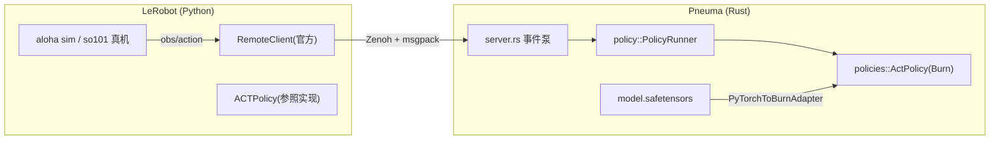

# DESIGN — 开发期快照（可推翻）

本文件记录 Pneuma 当前的边界与路线选择，供讨论先改文档、再改代码。
开发阶段一切可推翻：讨论改了边界，先改本文件。

## 边界

- **Pneuma（本仓，Rust）**：remote-inference v1 服务端 + Burn 策略运行时。拥有协议、合约、权重加载、推理执行。
- **LeRobot（外部，Python）**：仿真环境、遥操作、数据集、训练、rollout 客户端。Pneuma 不复制它，只对接。
- 概念对齐：一个策略 = 一个 `policy::PolicyRunner` 实现；一个部署 = 一套合约 profile；协议字段、semantics、类型名一处一名，不留第二套说法。

## 运行时决策：Burn 单路径

1. **实现**：策略用 Burn 手写模块，结构体与字段名对齐 PyTorch 属性名（`ACTPolicy`、`resnet`、`encoder`…），使权重键无需批量重映射。不用 `burn-onnx`，不用 `ort`——lerobot checkpoint 本身就是 `model.safetensors` + `config.json`，ONNX 中介只会引入算子覆盖与动态 shape 两类无谓风险。
2. **版本**：pin `burn = 0.22.0-pre.3`（0.22 与 0.21 API 断裂：`Tensor::<D>` 不再泛型于 Backend；`cargo add burn` 默认拉的 0.21 是旧 API）。MSRV 1.95，本机 nightly 1.101 满足。
3. **后端**：`model.device=auto|flex|metal` 选择设备；`auto` 使用 `Device::default()`（启用后端 GPU 优先于 CPU，遵循 Burn 的 `BURN_DEVICE` 默认设备机制），显式 `flex`/`metal` 调用对应构造器。编译期同时启 `flex`（纯 Rust CPU，数值可复现）与 `metal`（Apple GPU）。`load` 末尾按 `execution.warmup_calls` 做零观测预热：metal 首推理的内核 JIT（秒级）挪进启动期，兼作权重/算子的加载自检。dtype 固定 f32。
4. **权重**：`burn-store` 的 `SafetensorsStore + PyTorchToBurnAdapter`；键对不上时按键 dump 对照修正，不做名称猜测。
5. **推理形态**：首版只做 plain chunk——观测进、`[chunk_size, action_dim]` 出，配合客户端 `chunk_merge=append`。temporal ensembling、RTC/blending、aligned merge 不在首版，入口处显式拒绝（与骨架既有原则一致）。

## 合约 profile

部署合约写在 TOML 文件中，字段分组沿用 LeRobot（`model`、`execution`、`zenoh`、`features`、`action_feature`）。`--config_path=server.toml` 指定文件，`--execution.action_fps=50` 等嵌套 CLI 参数覆盖文件，最后统一做类型和交叉校验；服务端不再读取 `PI_*` 环境变量。so101 / aloha_sim 是 `examples/` 下的部署示例，不在源码中维护另一套 profile。

`model.policy=echo|act` 选择实现，`model.repo_or_path` 为本地 checkpoint 目录；`model.device=auto|flex|metal` 显式选择 Burn 后端。ACT 的预测/执行步数默认取 checkpoint，`execution.n_action_steps` 可限制执行片段；echo 的步数在示例中显式声明。配置中不支持的字段或取值在启动时拒绝。

| profile | state | 相机 | action | action_interval | semantics |
|---|---|---|---|---|---|
| `so101.toml`（echo 冒烟） | 6×f32 | front 480×640×3 u8 | 6×f32 | 1/30 | `so101-degrees-gripper-percent-v1` |
| `aloha_sim.toml`（仿真主线） | 14×f32 | top 480×640×3 u8 | 14×f32 | 1/50 | `aloha-sim-14d-v1` |

`aloha_sim` 的 `prediction_steps`/`execution_steps` 从 checkpoint `config.json` 的 `chunk_size`/`n_action_steps` 读取，不二次发明。图像 resize/归一化等预处理归 Burn 侧（对照 lerobot processor 管线实现），Python 端只发环境原图。

## 首个策略：官方 ACT（aloha 仿真）

权重取官方 `lerobot/act_aloha_sim_transfer_cube_human`（官方 namespace 唯一的仿真 ACT checkpoint；pusht 官方无 ACT）。移植面：ResNet18（conv/BN/残差/pool）+ Transformer encoder-decoder + 位置编码 + action/state 投影，`burn::nn` 构件齐备。

## 里程碑

| # | 交付 | 通过判据 |
|---|---|---|
| M1 | `aloha_sim` profile + so101 回归 | `integration_smoke.py` 双 profile 均绿；`cargo test` 绿 |
| M2 | Burn ACT 移植 + safetensors 加载 | `scripts/dump_act_reference.py` 生成参照产物，ignored 测试 `act_parity` 对齐 Burn `run` 与 Python `predict_action_chunk`+Unnormalize（f32 容差 ~1e-4；实测 max abs diff 3e-7）；`act_bisect_stages` 按 backbone/encoder 分段定位 |
| M3 | 仿真 harness `scripts/sim_rollout.py` | aloha env ↔ 官方 `RemoteClient` 闭环（connect→admit→infer→step）；rollout CLI 是 robot-only、eval 不接 remote，此 harness 即「无硬件全链路」正式替身；记录 roundtrip 与任务成功率 |
| M4 | GPU 后端 | `BURN_DEVICE=metal` 下 parity 与 M3 重跑通过，给出延迟对比（实测 parity 2.7e-7；worker med 317→48ms，6.6×；成功率 metal 3/5 vs flex 4/5，5-ep 小样本，混沌敏感） |

依赖安装走 lerobot extras：`.[remote,aloha]`（`gym-aloha` 由 pyproject 钉版；本机装不上则按既有备选降级 pusht + 社区权重）。每个里程碑收口都重跑 M1 判据，防真机 profile 回归。
