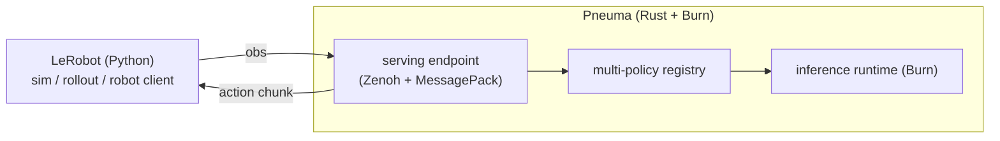
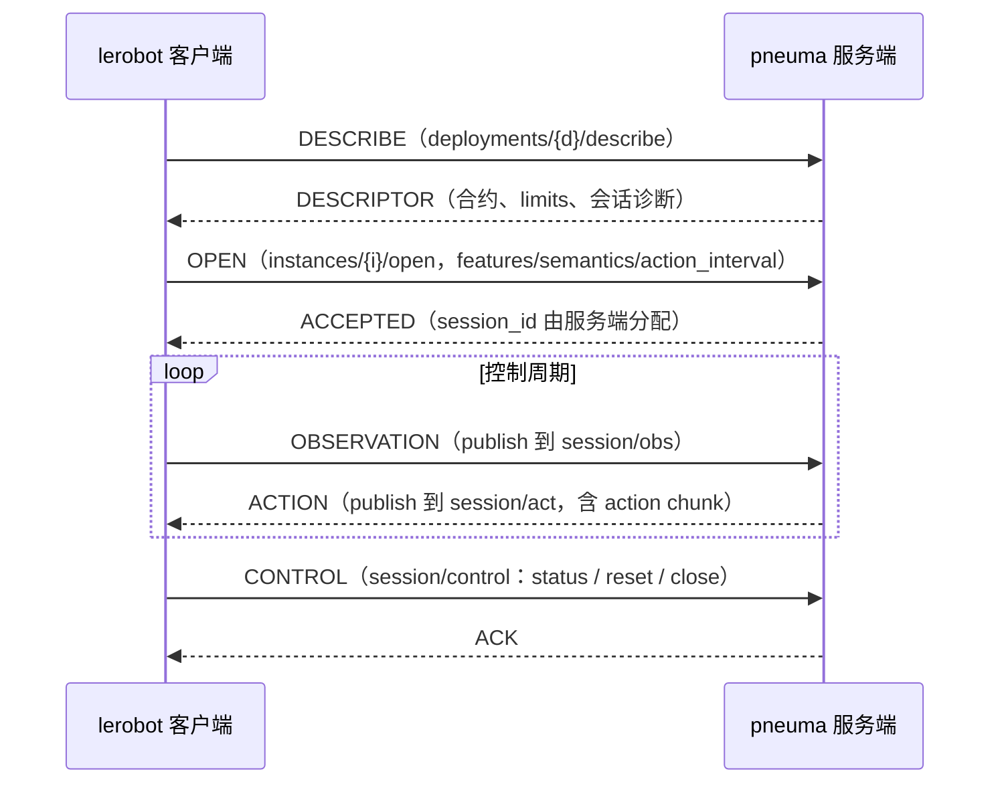

# Pneuma

**The breath of action — a Burn-powered multi-policy runtime for embodied agents.**

Pneuma 用 [Burn](https://github.com/tracel-ai/burn) 在 Rust 中实现可扩展的策略推理与服务，
并把策略接到 [LeRobot](https://github.com/huggingface/lerobot) 上做仿真与评估。

> 策略是机器人的气息（πνεῦμα / pneuma）：身体已在，行动由它唤起。

## 为什么做 Pneuma

Rust 在机器人学习里越来越有吸引力，但：

- **仿真与具身生态仍然稀薄**，很难在纯 Rust 里闭环「训练 → 仿真 → 真机」
- 现有策略栈（LeRobot、各类 VLA）多以 Python 为中心
- 大模型策略需要稳定的 **远程推理 / 多模型服务**，而不是一次性脚本

因此 Pneuma 的阶段性选择是：

1. 用 **Burn** 在 Rust 侧实现高性能策略运行时与服务
2. 先 **对接 LeRobot**，复用其仿真、数据与评估链路
3. 把「多模型策略」收敛成统一的服务契约，而不是为每个模型写一套胶水

## 项目定位

| 是 | 不是 |
|----|------|
| 多策略 / 多模型的推理运行时 | 又一个训练框架 |
| Burn 原生的策略服务层 | Python 策略的简单包装器 |
| 通往 LeRobot 仿真与评估的桥 | 绑死在单一机器人或单一模型上 |
| 为具身智能准备的 Rust 基础设施 | 完整的仿真器替代品 |

一句话：

> **Pneuma 负责把策略变成可调用的行动气息；LeRobot 负责让这口气在仿真与机器人里跑起来。**

## 设计意象

- **Pneuma（气息）**：策略不是身体，而是使身体行动的东西
- **Burn（火）**：推理在这里被点燃、被执行
- **多策略**：不同模型可以成为不同的气息，装入同一套运行时
- **具身**：最终要落到 observation → action，在仿真或真机中闭环

## 规划中的能力

- **多模型策略后端**
  以统一接口承载多种策略类型（先覆盖常见 action-chunk / VLA 推理形态）

- **策略服务（Policy Server）**
  在独立进程中运行推理，支持与机器人控制端解耦

- **LeRobot 对接**
  优先服务 LeRobot 的仿真与 rollout / remote inference 场景

- **Burn 原生执行**
  模型加载、预处理、推理与后处理尽量留在 Rust / Burn 路径上

- **清晰的数据契约**
  observation / action 的 shape、dtype、semantics 显式化，避免隐式 pickle 式耦合

> 当前仓库处于早期阶段，接口与协议仍可能快速迭代。

## 架构草图



---

## 当前实现：remote-inference v1 Rust 服务端骨架

lerobot **remote-inference v1** 协议（Zenoh + MessagePack）的 Rust 服务端——
「LeRobot 对接」的第一块落地。目标是让 `lerobot-rollout --inference.type=remote`
的 Python 客户端零改动连入本服务；推理后端目前是 echo 桩（返回全零 action chunk），
接真实模型时替换 `policy::PolicyRunner` 实现（Burn 运行时在此接入）。

协议事实对齐 lerobot main @ `f9e9d739e`（2026-10-22）：`src/lerobot/remote_inference/`
与 `src/lerobot/inference/contracts.py`。边界与路线决策见 `DESIGN.md`（开发期可推翻快照）。

### 会话消息流



### 通道布局

所有 key 在 `lerobot/inference/v1/deployments/{deployment}` 之下：

| key 后缀 | 方向 | 说明 |
|---|---|---|
| `/describe` | queryable | 描述符查询（deployment 级） |
| `instances/{i}/open` | queryable | 独占准入；成功后服务端生成 session_id |
| `instances/{i}/alive` | liveliness token | 服务端启动代在场 |
| `sessions/{s}/control` | queryable | status / reset / close |
| `sessions/{s}/obs` → `/act` | sub → pub | 观测进、动作块出 |

### 模块边界

- `protocol.rs` — 线协议契约：寻址、信封、FeatureSpec/Capabilities（对 `protocol.py`、`contracts.py`）
- `codec.rs` — 有界 MessagePack：拒绝 ext/NaN/重复键，tensor/rgb typed record（对 `codec.py`）
- `server.rs` — Zenoh IO 泵与单会话状态机（对 `server.py` 的通道布局）
- `policy/mod.rs` — 推理后端边界，`EchoPolicy` 为全零桩，ACT 读取 checkpoint 元数据
- `config.rs` — TOML 部署配置、嵌套 CLI 覆盖与启动校验
- `examples/so101.toml`、`examples/aloha_sim.toml` — 显式观测/动作合约

### 骨架范围

已实现：describe/open 准入校验（semantics、mode、action_interval、features、encoding、
append chunk_settings）、observation 逐特征合约校验、plain chunk 回复、control 最小 ACK。

未实现（入口处显式返回协议错误或未声明通道，不静默）：
aligned chunk merge、RTC/blending、language 语义（通道已按客户端准入要求声明，
请求一律回 UNSUPPORTED）、客户端 liveliness 与缺席宽限。

### 运行与测试

```sh
cargo run -- --config_path=examples/so101.toml
cargo test
cargo run -- --help
```

启动方式沿用 LeRobot 的「配置文件 + CLI 覆盖」，文件格式为 TOML。覆盖顺序为：
结构体默认值 < TOML 文件 < CLI；合并后校验，未知字段、非法数值与不支持的配置在启动时报错。
必须显式指定 `--config_path`，不再读取服务端 `PI_*` 环境变量。

```sh
# 临时改频率和监听地址；数组值使用 TOML 语法，外层引号交给 shell。
cargo run -- --config_path=examples/so101.toml \
  --execution.action_fps=50 \
  --zenoh.listen_endpoints='["tcp/127.0.0.1:7555"]'

# ACT：使用已下载到本机的 checkpoint；metal 为 Apple GPU，flex 为纯 Rust CPU。
cargo run --release -- --config_path=examples/aloha_sim.toml \
  --model.repo_or_path=/absolute/path/to/checkpoint \
  --model.device=metal \
  --execution.n_action_steps=50
```

`model`、`execution`、`zenoh` 字段分组及 `features`、`action_feature` 命名与 LeRobot 对齐。
Pneuma 扩展 `model.policy=echo|act`；`model.repo_or_path` 当前只接受本地 checkpoint，
`model.device=auto|flex|metal` 对应 Burn 后端（`auto` 使用 Burn 默认设备）。
ACT 的预测步数与默认执行步数来自 checkpoint，`execution.n_action_steps` 可覆盖执行步数；
echo 要求显式声明 `execution.prediction_steps`。`execution.warmup_calls` 默认为 2。
`so101.toml` 为 echo 零动作协议冒烟，`aloha_sim.toml` 为 14 维 ACT 仿真合约。
路径相对进程工作目录解析，含空格的路径应给整个 CLI 参数加 shell 引号。

`zenoh.config_file` 可指定 JSON5 安全配置底座（TLS、证书、ACL），
`zenoh.mode`、`zenoh.listen_endpoints`、`zenoh.connect_endpoints` 显式覆盖底座拓扑，
包括空数组；multicast/gossip 侦察关闭，连通性只靠显式 endpoints。
`features`/`action_feature` 可整体用 TOML inline table 数组/表覆盖，通常直接编辑文件更清楚。

### 真机联调步骤

1. **无硬件冒烟（已通过）**：用官方 Python 客户端类直连骨架，验证 codec 与准入协议。

   ```sh
   uv venv .venv --python 3.12
   uv pip install -p .venv/bin/python -e "<lerobot 仓>[remote]"
   cargo run -- --config_path=examples/so101.toml &
   .venv/bin/python scripts/integration_smoke.py
   ```

2. **rollout 全链路（仿真或无动作机器人）**：

   ```sh
   lerobot-rollout \
     --inference.type=remote \
     --inference.deployment=manipulation \
     --inference.semantics=so101-degrees-gripper-percent-v1 \
     --inference.chunk_merge=append \
     --inference.endpoint=tcp/<服务端IP>:7447 \
     --robot.type=so101_follower --robot.port=/dev/ttyACM0 --robot.cameras='{front: ...}' \
     --fps=30
   ```

   注意：`chunk_merge` 默认 `auto` 会解析为 aligned，骨架会显式拒绝——联调必须传 `append`；
   `--fps` 决定客户端 action_interval，必须等于服务端的 `1/execution.action_fps`。

3. **常见失败与含义**：`BUSY`+`admission_blocker`＝已有会话占用；
   `INCOMPATIBLE feature/order`＝机器人相机名/rename_map 与骨架特征合约不一致（改
   TOML 中的 `features` 或客户端相机名）；`TimeoutError ... discovery`＝endpoint 不通或
   deployment 名不符。
