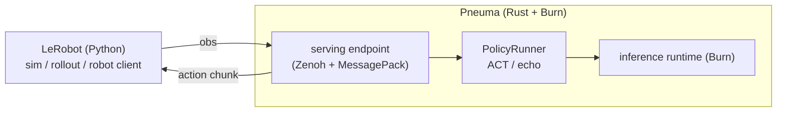
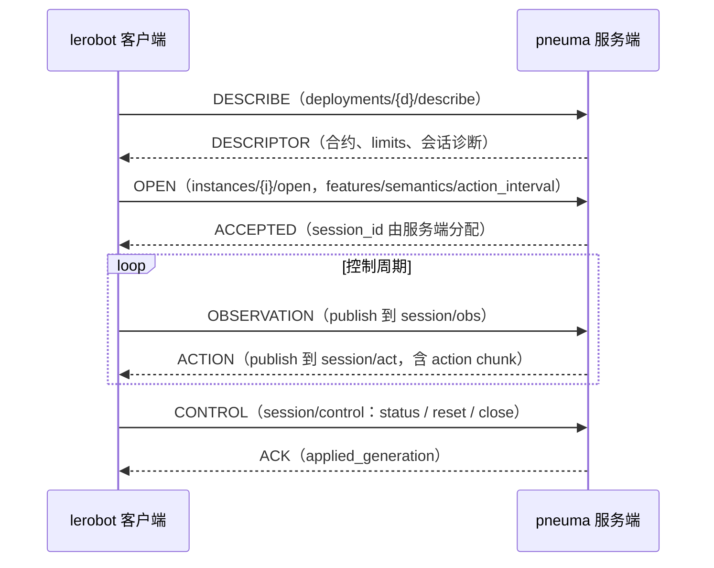

# Pneuma

**The breath of action — a Burn-powered multi-policy runtime for embodied agents.**

Pneuma 用 [Burn](https://github.com/tracel-ai/burn) 在 Rust 中实现可扩展的策略推理与服务，
并把策略接到 [LeRobot](https://github.com/huggingface/lerobot) 上做仿真与评估。

> 策略是机器人的气息（πνεῦμα / pneuma）：身体已在，行动由它唤起。

## 为什么做 Pneuma

Rust 在机器人学习里越来越有吸引力，但：

- **仿真与具身生态仍然稀薄**，很难在纯 Rust 里闭环「训练 → 仿真 → 真机」
- 现有策略栈（LeRobot、各类 VLA）多以 Python 为中心
- 大模型策略需要稳定的 **远程推理 / 多模型服务**，而不是一次性脚本

因此 Pneuma 的阶段性选择是：

1. 用 **Burn** 在 Rust 侧实现高性能策略运行时与服务
2. 先 **对接 LeRobot**，复用其仿真、数据与评估链路
3. 把「多模型策略」收敛成统一的服务契约，而不是为每个模型写一套胶水

## 项目定位

| 是 | 不是 |
|----|------|
| 多策略 / 多模型的推理运行时 | 又一个训练框架 |
| Burn 原生的策略服务层 | Python 策略的简单包装器 |
| 通往 LeRobot 仿真与评估的桥 | 绑死在单一机器人或单一模型上 |
| 为具身智能准备的 Rust 基础设施 | 完整的仿真器替代品 |

一句话：

> **Pneuma 负责把策略变成可调用的行动气息；LeRobot 负责让这口气在仿真与机器人里跑起来。**

## 设计意象

- **Pneuma（气息）**：策略不是身体，而是使身体行动的东西
- **Burn（火）**：推理在这里被点燃、被执行
- **多策略**：不同模型可以成为不同的气息，装入同一套运行时
- **具身**：最终要落到 observation → action，在仿真或真机中闭环

## 规划中的能力

- **多模型策略后端**
  以统一接口承载多种策略类型（先覆盖常见 action-chunk / VLA 推理形态）

- **策略服务（Policy Server）**
  在独立进程中运行推理，支持与机器人控制端解耦

- **LeRobot 对接**
  优先服务 LeRobot 的仿真与 rollout / remote inference 场景

- **Burn 原生执行**
  模型加载、预处理、推理与后处理尽量留在 Rust / Burn 路径上

- **清晰的数据契约**
  observation / action 的 shape、dtype、semantics 显式化，避免隐式 pickle 式耦合

> 当前仓库处于早期阶段，接口与协议仍可能快速迭代。

## 架构草图



---

## 当前实现：remote-inference v1 与 Burn ACT 推理

Pneuma 实现 LeRobot **remote-inference v1** 协议（Zenoh + MessagePack），通过官方
`RemoteClient` 接收观测并返回动作块。ACT 后端用 Burn 执行 ResNet18 与 Transformer，
直接加载本地 safetensors checkpoint，提供 Flex CPU 和 Metal GPU 推理。
`model.policy=echo` 返回全零动作块，用于协议与会话冒烟；策略扩展边界是 `policy::PolicyRunner`。

协议事实对齐 lerobot main @ `f9e9d739e`（2026-10-22）：`src/lerobot/remote_inference/`
与 `src/lerobot/inference/contracts.py`。边界与路线决策见 `DESIGN.md`（开发期可推翻快照）。

### 会话消息流



### 通道布局

所有 key 在 `lerobot/inference/v1/deployments/{deployment}` 之下：

| key 后缀 | 方向 | 说明 |
|---|---|---|
| `/describe` | queryable | 描述符查询（deployment 级） |
| `instances/{i}/open` | queryable | 独占准入；成功后服务端生成 session_id |
| `instances/{i}/alive` | liveliness token | 服务端启动代在场 |
| `sessions/{s}/control` | queryable | status / reset / close |
| `sessions/{s}/obs` → `/act` | sub → pub | 观测进、动作块出 |

### 模块边界

- `protocol.rs` — 线协议契约：寻址、信封、FeatureSpec/Capabilities（对 `protocol.py`、`contracts.py`）
- `codec.rs` — 有界 MessagePack：拒绝 ext/NaN/重复键，tensor/rgb typed record（对 `codec.py`）
- `server.rs` — Zenoh IO 泵与单会话状态机（对 `server.py` 的通道布局）
- `policy/mod.rs` — 策略选择与 `PolicyRunner` 边界；`ZeroActionPolicy` 提供全零冒烟动作
- `policy/act/` — ACT 模型、checkpoint 加载、特征约束、归一化及 Burn 前向推理
- `cli.rs` — clap derive 分组参数和常用启动选项覆盖；`main` 处理帮助、版本及参数退出
- `config.rs` — `ServerConfig` 读取 TOML 与最终配置校验
- `examples/so101.toml`、`examples/aloha_sim.toml` — 显式观测/动作合约

### 支持范围

已实现：describe/open 独占准入（semantics、mode、action_interval、features、raw encoding、
append chunk_settings）、观测逐特征合约校验、Burn ACT plain chunk 推理，以及 status/reset/close
会话控制。DESCRIBE 报告当前 owner 和可用状态；观测必须匹配实例、会话和当前 generation。
RGB 与 tensor 均使用 raw 记录，JPEG 在准入时拒绝。

会话状态由单个 pump 持有，同步推理在一个阻塞任务中执行。入口有界，运行中的推理占用全实例唯一名额；
忙时返回 Busy，超量消息在回复名额或入口已满时丢弃。reset/close 可以在推理期间推进，旧任务结束前不启动
第二次推理；完成时已失效的 session/generation 结果会被丢弃。ACTION 分别报告真实排队与推理耗时。

未实现（入口处显式返回协议错误或未声明通道，不静默）：
aligned chunk merge、RTC/blending、language 语义（通道已按客户端准入要求声明，
请求一律回 UNSUPPORTED）、客户端 liveliness 与缺席宽限。

### 运行与测试

```sh
cargo run -- --config=examples/so101.toml
cargo test
cargo run -- --help
```

启动方式沿用 LeRobot 的「配置文件 + CLI 覆盖」，文件格式为 TOML。覆盖顺序为：
结构体默认值 < TOML 文件 < CLI；合并后校验，未知字段、非法数值与不支持的配置在启动时报错。
必须显式指定 `--config`，不再读取服务端 `PI_*` 环境变量。

```sh
# 临时改频率和监听地址。
cargo run -- --config=examples/so101.toml \
  --action-fps=50 \
  --listen=tcp/127.0.0.1:7555

# ACT：使用已下载到本机的 checkpoint；metal 为 Apple GPU，flex 为纯 Rust CPU。
cargo run --release -- --config=examples/aloha_sim.toml \
  --checkpoint=/absolute/path/to/checkpoint \
  --device=metal \
  --action-steps=50
```

`model`、`execution`、`zenoh` 字段分组及 `features`、`action_feature` 命名与 LeRobot 对齐。
Pneuma 扩展 `model.policy=echo|act`；`model.repo_or_path` 当前只接受本地 checkpoint，
`model.device=auto|flex|metal` 对应 Burn 后端（`auto` 使用 Burn 默认设备）。
ACT 的预测步数与默认执行步数来自 checkpoint，`execution.n_action_steps` 可覆盖执行步数；
echo 要求显式声明 `execution.prediction_steps`。`execution.warmup_calls` 默认为 2。
`so101.toml` 为 echo 零动作协议冒烟，`aloha_sim.toml` 为 14 维 ACT 仿真合约。
路径相对进程工作目录解析，含空格的路径应给整个 CLI 参数加 shell 引号。

`zenoh.config_file` 可指定 JSON5 安全配置底座（TLS、证书、ACL），
`zenoh.mode`、`zenoh.listen_endpoints`、`zenoh.connect_endpoints` 显式覆盖底座拓扑，
包括空数组；multicast/gossip 侦察关闭，连通性只靠显式 endpoints。
CLI 使用常规长选项，不再接受 `--model.device` 等点号参数。完整 schema、semantics、
部署名称和安全配置在 TOML 中修改。常用选项为 `--checkpoint`、`--device`、`--policy`、
`--action-fps`、`--action-steps`、`--prediction-steps`、`--warmup-calls` 和 `--zenoh-mode`。
`--listen`、`--connect` 可重复使用，出现时替换对应的整个地址列表；未提供则保留文件值。
`--clear-listen`、`--clear-connect` 清空对应列表，分别与 `--listen`、`--connect` 互斥。
例如将 peer 部署临时切到 client：

```sh
cargo run -- --config=examples/so101.toml \
  --zenoh-mode=client --clear-listen --connect=tcp/127.0.0.1:7447
```

CLI 只覆盖显式提供的值，不经 TOML 字面量解析；应用覆盖后统一校验。
`--help` 和 `--version` 返回 0，参数错误返回 2，文件加载或配置校验失败返回 1。

### ALOHA 配对 benchmark

```sh
cargo build --release
.venv/bin/python scripts/sim_rollout.py --backend=all --episodes=50 \
  --checkpoint=/absolute/path/to/checkpoint \
  --output=outputs/aloha-paired.json
# 中断后使用相同参数，加 --resume 继续已完成的逐局结果。
```

需要 LeRobot 的 `.[remote,aloha]` 依赖及 ACT 所用的 PyTorch、torchvision、einops。未指定 `--checkpoint` 时沿用
`PNEUMA_ACT_CKPT`，再查找本机官方 Transfer Cube checkpoint 缓存。
默认种子 0–49，每局上限 400 步（沿用 LeRobot AlohaEnv 配置）；`--seed-start`
和 `--episode-length` 可覆盖。gym-aloha 的渲染可能有轻微非确定性，报告会核对初始
物理状态，并单列初始图像不一致的种子。Python ACT 在 CPU 上执行，默认 PyTorch
单线程；Rust Flex 和 Metal 服务由脚本依次启动，使用空闲本地端口并在结束时清理。
三方采用相同 checkpoint、480×640 图像及 plain chunk，默认执行 checkpoint 的
`n_action_steps`（当前官方权重为 100）；`--action-steps` 可以统一覆盖三方执行长度。
`--backend=python|flex|metal` 可单独运行；`--backend=remote --endpoint=...`
可连接已有服务，此模式需自行保证服务权重与 `--checkpoint` 一致。

JSON 结果保存 checkpoint/源文件/服务端二进制哈希、依赖版本、初始观测摘要及每局成功率、
步数和逐请求延迟；每完成一局原子写入。续跑要求元数据相同，防止混入不同实现的结果。
汇总给出成功率 Wilson 95% 区间、逐种子胜负及配对 bootstrap 差值区间。
Python 的请求计时包含本地前后处理和推理，Rust 的请求计时还包含协议与传输；
Rust `worker_ms` 单列。仿真按步推进，不能据此判断真实时间控制截止时间是否满足。
该评测建立描述性基线，允许的成功率偏差尚未约定，因此不输出非劣性验收通过结论。
生成结果和服务日志存放于已忽略的 `outputs/` 中。

2026-10-28 本机首轮结果：官方 `act_aloha_sim_transfer_cube_human` checkpoint
`ba73b2766f1371cdc133ca4efb97eb090d744625`，种子 0–49，执行块 100 步、每局上限
400 步，Python CPU 单线程，三方各 50 局。完整记录为 `outputs/aloha-paired-50.json`。

| 实现 | 成功率 | Wilson 95% 区间 | 请求耗时中位 / P95 | 服务端 worker 中位 / P95 |
|---|---|---|---|---|
| Python ACT（CPU） | 43/50，86% | 73.8%–93.0% | 177.7 / 568.7 ms | — |
| Rust Flex | 44/50，88% | 76.2%–94.4% | 290.9 / 483.3 ms | 288.9 / 474.0 ms |
| Rust Metal | 44/50，88% | 76.2%–94.4% | 46.1 / 72.6 ms | 44.6 / 69.7 ms |

所有配对初始物理状态和图像摘要一致。Flex、Metal 与 Python 的成功与否均只在种子 0
不同（Python 失败、Rust 成功），成功率差值均为 +2 个百分点，配对 bootstrap 95%
区间为 [0, +6] 个百分点。这个有限样本经验区间不能证明 Rust 优于 Python，亦不能
替代预先定义偏差界限的非劣性检验；本轮未观察到成功率下降。
Metal 的 worker 中位耗时较 Flex 加速约 6.47 倍。请求耗时统计按实际推理请求汇总，
不同轨迹的请求数分别为 171、170、172，属于各自闭环工作负载的描述性延迟。

### 真机联调步骤

1. **无硬件冒烟（已通过）**：用官方 Python 客户端连接 echo 服务，验证全零动作、reset/Stale 和 close/reopen。

   ```sh
   uv venv .venv --python 3.12
   uv pip install -p .venv/bin/python -e "<lerobot 仓>[remote]"
   cargo run -- --config=examples/so101.toml &
   .venv/bin/python scripts/integration_smoke.py
   ```

2. **rollout 全链路（仿真或无动作机器人）**：

   ```sh
   lerobot-rollout \
     --inference.type=remote \
     --inference.deployment=manipulation \
     --inference.semantics=so101-degrees-gripper-percent-v1 \
     --inference.chunk_merge=append \
     --inference.endpoint=tcp/<服务端IP>:7447 \
     --robot.type=so101_follower --robot.port=/dev/ttyACM0 --robot.cameras='{front: ...}' \
     --fps=30
   ```

   注意：`chunk_merge` 默认 `auto` 会解析为 aligned，骨架会显式拒绝——联调必须传 `append`；
   `--fps` 决定客户端 action_interval，必须等于服务端的 `1/execution.action_fps`。

3. **常见失败与含义**：`BUSY`+`admission_blocker`＝已有会话占用；
   `INCOMPATIBLE feature/order`＝机器人相机名/rename_map 与骨架特征合约不一致（改
   TOML 中的 `features` 或客户端相机名）；`TimeoutError ... discovery`＝endpoint 不通或
   deployment 名不符。
