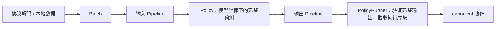

# 通用 processor pipeline

[返回 README](../README.md) · [设计边界](../DESIGN.md)

Pneuma 以一套有序数据转换服务模型推理和后续训练。ACT 的旧权重归一化缓冲、
SmolVLA 的 LeRobot processor JSON 在加载时导入同一套步骤，运行时不再保留模型专用预处理路径。

## 调用路径



`contract::FeatureSpec` 表达部署特征和语义；`processor::Schema` 表达每一步的数据形状、dtype、
layout 和可选性。二者用途不同：前者描述边界数据，后者描述转换过程中每个字段的表示。
`codec` 转换 MessagePack 与 `Batch`；模型与 pipeline 不依赖协议类型。

`Batch.values` 保存具名主机数组或 Burn tensor，`Batch.tasks` 保存逐样本任务文本。
F32 主机数组有显式 shape；设备值区分浮点 rank 2/3/4、整数 rank 2 与布尔 rank 2。
Schema 中 `None` 表示动态维度，`optional` 允许训练动作目标在推理时缺省；未声明字段会报错。
整数 schema 表达逻辑 I64，实际 Burn 设备可以用 I32 存储，取回时使用显式元素转换。

## 步骤与训练语义

当前步骤为版本化 `Step` 枚举：Rename、Batch、Rgb、ResizePad、Affine、Linear、Pad、Crop、
Newline、Tokenize、Device、Host。未知步骤、版本或参数会在加载时拒绝。

- `Batch` 给单样本主机数据增加大小为 1 的 batch 轴。训练已有 batch 的数据使用相应 schema，省略此步骤。
- `Rgb` 将 `[B,H,W,3]` uint8 转成 `[B,3,H,W]` F32 并除以 255。
- `ResizePad` 使用 half-pixel 双线性插值，零 padding 在左侧和顶部；数值范围变换用独立步骤表达。
- `Affine` 执行 `(x-offset)/scale`；`Linear` 执行 `x*scale+offset`，按明确指定的轴广播。
- `Pad` / `Crop` 改变末维。状态与训练动作先按真实维度归一化再补零；输出先裁真实动作维度再反归一化。
- `Tokenize` 从本地资源构造，显式保存 max length、padding 策略与方向，截断方向来自 tokenizer 配置。
- `Device` 显式上传或迁移设备；`Host` 导出浮点 tensor，但禁止训练模式和自动微分 tensor，防止隐式截断梯度。

`Context` 显式指定 `Train/Eval` 与设备。tensor 的 Affine、Linear、Crop 和 Device 保留自动微分图；
RGB、ResizePad 与 Pad 当前处理主机数组。pipeline 构造时推导各步 schema，执行时校验动态形状，
输入输出检查数值有限性。任务数量需要与显式 batch 维匹配。

输入 pipeline 可同时归一化观测与可选动作目标，供模型坐标下的 loss 使用；输出 pipeline 还原
canonical 动作。当前 ACT / SmolVLA 模型接口仍只实现单样本预测，尚无 loss、优化器、训练循环、
统计 fit、随机增强或训练恢复 API。自动微分测试验证的是 pipeline 本身，不能视作模型训练已完成。
首批步骤均确定性，不提供无实际用途的 RNG 接口；未来随机步骤必须定义播种与恢复语义。

## pipeline 保存加载

```rust,no_run
use pneuma::processor::Pipeline;
use std::path::Path;

fn roundtrip(pipeline: &Pipeline) -> anyhow::Result<Pipeline> {
    pipeline.save(Path::new("outputs/input-pipeline"))?;
    Pipeline::load(Path::new("outputs/input-pipeline"))
}
```

目录内 `pipeline.json` 保存 schema、有序步骤和版本；Affine / Linear 统计存入
`statistics.safetensors`，tokenizer 保存为相对路径资源，各文件有 SHA256 摘要。
保存使用构造时 tokenizer 快照，源目录删除后仍能保存。加载不联网，拒绝损坏、未知版本、越界引用、
未声明资源和 schema 推导不一致。

## 原生 checkpoint 与转换

模型内部统一使用 Burn `ModuleRecord` 的 `.bpk`，`convert` 负责 LeRobot 互操作，`serve` 只接受原生 checkpoint：

```sh
cargo run --release -- convert --from=lerobot --to=pneuma \
  --input=/absolute/path/to/lerobot-checkpoint \
  --output=outputs/policy-native \
  --vlm-path=/absolute/path/to/SmolVLM2-500M-Video-Instruct

cargo run --release -- serve --config=/absolute/path/to/deployment.toml \
  --checkpoint=/absolute/path/to/policy-native

cargo run --release -- convert --from=pneuma --to=lerobot \
  --input=outputs/policy-native --output=outputs/lerobot-export
```

ACT 导入省略 `--vlm-path`。转换只接受本地单文件 `model.safetensors`；分片输入初版明确拒绝。
产物版本 2 包含 `manifest.json`、`model/config.json`、`model/model.bpk`、两条 pipeline，
SmolVLA 另含 `vlm/`。原始 processor 配置与统计、完整参数清单和转换来源存入 `interop/`；
当前推理模块未使用的源参数作为 `interop/extra.bpk` 保存，保持原 dtype、shape 与值。
不存在原模型 safetensors 副本；反向导出从当前原生模型读取 active 参数并与附属参数合并。
转换记录 dtype 变化，当前 active 参数采用 F32，不承诺 BF16 字节级往返。

服务配置不再接受 `model.vlm_path`，服务 CLI 也不再接受 `--vlm-path`；VLM 资源归原生 checkpoint 所有。
外部输入 schema 必须与 profile 一致，输出必须符合完整预测长度和 canonical 动作维度。
执行片段由 runner 统一截取。旧版本 1 部署产物不再加载，请从原始 LeRobot checkpoint 重新转换。

`Checkpoint::save` 通过模型保存回调写入实际 `ModuleRecord`，包含参数身份，支持后续原生训练保存。
当前模型训练循环尚未实现，保留的附属参数不参与 Pneuma 计算或训练。导出只处理模型及资源，
不转换优化器、调度器或训练恢复状态；pipeline 修改后反向导出明确拒绝，避免套用过时的 LeRobot processor。
导出核对全量参数键名和形状。保存先写临时目录并验证，拒绝覆盖已有目标，目标须为单写者。

## 初版转换验收（2026-10-30）

本机真实 checkpoint 完成 LeRobot → bpk → LeRobot：SmolVLA 500 个 tensor 在显式 dtype 转换后逐值一致
（473 个由 BF16 等类型转为 F32），ACT 242 个 tensor 完全一致。SmolVLA 通过官方策略严格加载；
旧 ACT checkpoint 的 8 个顶层归一化缓冲保持原格式，网络本体按既有官方参照入口严格加载，
不宣称旧 ACT checkpoint 已迁成当前 LeRobot 的独立 processor 格式。
原生 bpk 加载的 Metal SmolVLA 通过完整固定噪声数值参照，以及官方客户端任务更新、reset、close 冒烟。

可复跑导出验收：

```sh
/path/to/python -I scripts/check_conversion.py \
  --source=/absolute/path/to/original-lerobot-checkpoint \
  --converted=/absolute/path/to/lerobot-export \
  --lerobot-src=/absolute/path/to/lerobot/src
```

原生 SmolVLA 数值参照可在既有 parity 命令上增加
`PNEUMA_SMOLVLA_NATIVE=/absolute/path/to/converted-parity-checkpoint`；应转换数值参照 fixture 的三相机 checkpoint，
不能用两相机 benchmark checkpoint 替代。

## 验证

```sh
cargo test
cargo clippy --all-targets --all-features -- -D warnings
cargo doc --no-deps
```

真实产物的官方客户端验证（需包含 LeRobot remote 依赖的 Python 环境）：

```sh
/path/to/python -I scripts/checkpoint_smoke.py \
  --config=/absolute/path/to/original-deployment.toml \
  --checkpoint=/absolute/path/to/policy-native \
  --lerobot-src=/absolute/path/to/lerobot/src
```

2026-10-30 本机迁移后验证：SmolVLA Flex / Metal 固定输入数值参照、ACT Metal 数值参照均通过，
沿用原有容差。真实 SmolVLA 产物导出并重新加载后，官方客户端完成两次 `[50,7]` 有限动作预测、
任务更新、reset 和 close；本次请求耗时约 961 / 1,839 ms，仅为联调记录。

普通测试覆盖 schema、训练/推理模式、梯度、可选动作目标、保存加载与资源摘要，以及协议任务条件、
reset 和旧结果隔离。真实 checkpoint 数值验证继续使用 [SmolVLA parity](smolvla.md#数值参照)
和 ACT 的 ignored parity 测试；两种模型均执行迁移后的公共 pipeline。
