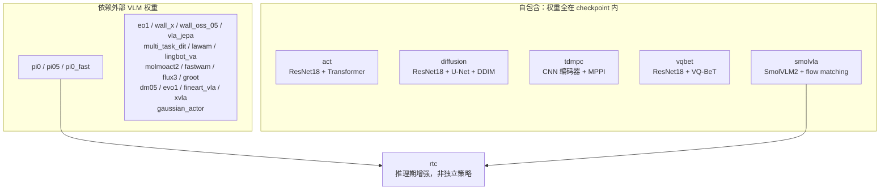
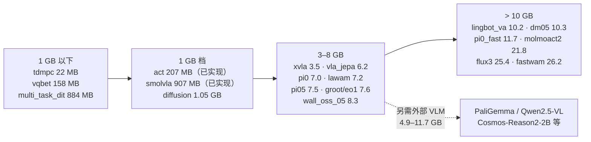

# LeRobot 策略全景与 Pneuma 进度

[返回 README](../README.md) · [设计快照](../DESIGN.md) · [通用 pipeline](pipeline.md)

本文记录 LeRobot 当前的策略清单、每个策略的基本形态，以及 Pneuma 已实现的部分。
事实对齐 LeRobot main @ `f9e9d739e`（2026-10-22），来源 `src/lerobot/policies/`。
清单随上游增加而变化，本文以该 commit 为快照。

## 分类与全景



判断口径是**能否只靠 checkpoint 目录完成推理**：自包含策略的 `from_pretrained`
不需要联网或额外模型仓库；依赖外部 VLM 的策略会加载 `transformers` / `diffusers`
模型（PaliGemma、Qwen2.5-VL、Qwen3-VL、InternVL3、Florence-2、CLIP、Wan2.2 等），
或要求 `base_model_path` 指向另一个 HF 仓库。Pneuma 目前只覆盖自包含一侧。

## LeRobot 策略清单

`type` 取自各策略 config 的 `@PreTrainedConfig.register_subclass`，是命令行 `--policy.type`
和 `config.json` 里 `type` 字段的取值。

| type | 方法 | 观察 | 动作头 | 外部权重 | checkpoint 大小 | Pneuma |
|---|---|---|---|---|---|---|
| `act` | ACT / ALOHA，VAE + Transformer 编码器 | RGB + state（可加 `env_state`） | 一次前向出整块 | 无（torchvision ResNet18 可选预训练） | **207 MB** | **已实现** |
| `smolvla` | SmolVLA，VLM + 动作专家 | 多视角 RGB + state + 语言 | flow matching，Euler | SmolVLM2-500M 资源目录 | **907 MB** | **已实现** |
| `tdmpc` | TD-MPC，隐空间模型预测控制 | 1 路方形 RGB + state（单步） | MPPI / CEM 规划 | 无 | **22 MB** | 未开始 |
| `vqbet` | VQ-BeT，离散动作码本 | 单视角 RGB + state（5 步观测） | VQ 码本 + GPT 式解码 | 可选 ResNet18 ImageNet | **158 MB** | 未开始 |
| `diffusion` | Diffusion Policy | 多视角 RGB + state（2 步观测） | DDIM 去噪 | 可选 ResNet18 ImageNet | **1.05 GB** | 未开始 |
| `multi_task_dit` | 多任务 DiT | 2 步观测 + 语言 | DiT 去噪 | CLIP ViT-B/16（598 MB） | **0.88 GB** | 未开始 |
| `xvla` | XVLA，soft prompt + 动作 hub | 多视角 RGB + state + 语言 | flow matching / 离散 | Florence-2（3.1 GB）+ BART（1.0 GB） | **3.52 GB** | 未开始 |
| `pi0` | π₀，Gemma + flow matching 专家 | 多视角 RGB + state + 语言 | flow matching | PaliGemma-3B（11.7 GB） | **7.0 / 14.0 GB** | 未开始 |
| `pi05` | π₀.₅，AdaRMS 时间条件 | 多视角 RGB + state + 语言 | flow matching | PaliGemma-3B（11.7 GB） | **7.5 / 14.5 GB** | 未开始 |
| `groot` | GR00T N1.7 | 多视角 RGB + state + 语言 | DiT 流匹配 | Cosmos-Reason2-2B（4.9 GB，需 `base_model_path`） | **7.6 GB** | 未开始 |
| `wall_oss_05` | Wall-OSS-0.5（4B） | 多视角 RGB + state + 语言 | flow matching | Qwen2.5-VL（7.5 GB） | **8.3 GB** | 未开始 |
| `eo1` | EO-1 | 多视角 RGB + state + 语言 | flow matching | Qwen2.5-VL | **7.6 GB** | 未开始 |
| `vla_jepa` | VLA-JEPA | 视频 + state + 语言 | DiT 流匹配 | Qwen3-VL + V-JEPA2 | **6.2 GB** | 未开始 |
| `lawam` | LaWAM，潜世界模型 | 多视角 RGB + state | 潜空间策略 | Qwen3-VL-2B | **7.2 GB** | 未开始 |
| `pi0_fast` | π₀-FAST，离散动作 token 自回归 | 多视角 RGB + state + 语言 | FAST 自回归解码 | PaliGemma-3B + FAST tokenizer | **11.7 GB** | 未开始 |
| `lingbot_va` | LingBot-VA，视频-动作世界模型 | 视频 + state + 语言 | 自回归视频+动作 | Wan2.2（VAE/UMT5） | **10.2 GB** | 未开始 |
| `dm05` | DM0.5 | 多视角 RGB + state + 语言 | flow matching | 内置 VLM（`core/`） | **10.3 GB** | 未开始 |
| `wall_x` | WALL-OSS | 多视角 RGB + state + 语言 | flow matching / FAST | Qwen2.5-VL + FAST tokenizer | **8.3 GB** | 未开始 |
| `fastwam` | FastWAM | 视频 + state + 语言 | 视频-动作联合 | Wan2.2-TI2V-5B（20 GB） | **26.2 GB** | 未开始 |
| `molmoact2` | MolmoAct2 | 多视角 RGB + state + 语言 | flow matching / FAST | `allenai/MolmoAct2`（21.8 GB） | **21.8 GB** | 未开始 |
| `flux3` | FLUX 3 Action（7B） | RGB + state + 语言 | 动作+帧联合去噪 | Qwen3-VL 文本编码器（8.9 GB）+ VAE | **25.4 GB** | 未开始 |
| `evo1` | EVO-1 | 多视角 RGB + state + 语言 | flow matching | InternVL3 | 无官方 LeRobot 权重 | 未开始 |
| `fineart_vla` | FineART-VLA（π₀.₅ + 语言头） | 多视角 RGB + state + 语言 | flow matching | PaliGemma-3B | 与 π₀.₅ 同量级 | 未开始 |
| `gaussian_actor` | 高斯 actor-critic | RGB + state（可选） | 高斯采样 | 可选视觉编码器（如 `lerobot/resnet10`，20 MB） | 无官方权重 | 未开始 |

`rtc`（Real-Time Chunking）不是独立策略：它是对 flow matching 策略的推理期增强，
把动作块生成当作 inpainting 处理，挂在 π₀ / π₀.₅ / SmolVLA 之上，配置项为 `RTCConfig`
（`guided` 为推理期 Jacobian 引导，`trained` 需要配套的 RTC 训练 checkpoint）。
Pneuma 的能力广播里有 `rtc_horizon` 字段，当前固定为 0。

## 权重大小与实现顺序

大小取 HF API 的仓库文件清单，只统计 `model.safetensors` 等权重文件。

| 来源 | 权重 | 说明 |
|---|---|---|
| `lerobot/act_aloha_sim_transfer_cube_human` | 206.8 MB | 已实现；`act_aloha_sim_insertion_human` 同为 206.8 MB |
| `lerobot/smolvla_base` / `lerobot/smolvla_libero` | 906.7 MB | 已实现；两者同大小 |
| `alexandersoare/tdmpc_pusht_keypoints` | 21.5 MB | 官方 hub 上无 `lerobot/tdmpc*`，此为上野社区权重 |
| `lerobot/vqbet_pusht` | 158.2 MB | |
| `lerobot/diffusion_pusht` | 1050.9 MB | `diffusion_pusht_keypoints` 为 995.1 MB |
| `naavox/multitask-dit` | 883.9 MB | 官方 hub 无 `lerobot/multi_task_dit*`，plus CLIP ViT-B/16 598.6 MB |
| `lerobot/xvla-base` / `lerobot/xvla-libero` | 3519.1 MB | Florence-2 3.1 GB + BART 1.0 GB 另计 |
| `lerobot/pi0_libero_finetuned_v044` | 7.0 GB | 微调版；`lerobot/pi0_base` 为 14.0 GB |
| `lerobot/pi05_libero_finetuned_v044` | 7.5 GB | 微调版；`lerobot/pi05_base` 为 14.5 GB |
| `aractingi/groot-libero-lerobot` | 7.6 GB | 官方 hub 无 `lerobot/groot*`；`nvidia/GR00T-N1.7-3B` 为 6.9 GB（2 分片） |
| `lerobot/eo1-base` | 7.6 GB | |
| `lerobot/VLA-JEPA-LIBERO` | 6.2 GB | |
| `jialei02/lawam-libero-sft-lerobot` | 7.2 GB | |
| `lerobot/pi0fast-base` | 11.7 GB | |
| `lerobot/lingbot_va_base` | 10.2 GB | |
| `lerobot/dm05_base` / `lerobot/dm05_libero` | 10.3 GB | 二者同大小 |
| `lerobot/wall-oss-0.5` / `x-square-robot/wall-oss-0.5` | 8.3 GB | |
| `ZibinDong/fastwam_libero_uncond_2cam224` | 26.2 GB | 12.0 GB 策略 + 11.4 GB UMT5 + 2.8 GB VAE |
| `lerobot/MolmoAct2-LIBERO-LeRobot` | 21.8 GB | 与 `allenai/MolmoAct2` 同大小 |
| `black-forest-labs/flux-3-action-base` | 25.4 GB | 14.0 GB 主干 + 8.9 GB 文本编码器 |



按大小排出的实现顺序，只考虑权重成本：

1. **已完成**：`act` 207 MB、`smolvla` 907 MB。
2. **< 1 GB 的轻量档**：`tdmpc` 22 MB、`vqbet` 158 MB、`multi_task_dit` 884 MB。
   下载与本地存储几乎不构成障碍，验收迭代也最快。
3. **1 GB 档**：`diffusion` 1.05 GB，与已实现的 SmolVLA 同量级，本机已跑通这个规模。
4. **3–8 GB 档**：`xvla` 3.5 GB、`vla_jepa` 6.2 GB、`pi0`/`pi05` 微调版 7.0/7.5 GB、
   `groot` 7.6 GB、`eo1` 7.6 GB、`lawam` 7.2 GB、`wall_oss_05` 8.3 GB。
   这里真正的成本不是策略 checkpoint，而是外部 VLM（PaliGemma 11.7 GB、
   Qwen2.5-VL 7.5 GB、Cosmos-Reason2-2B 4.9 GB），要额外下载并在 Burn 侧实现。
5. **> 10 GB 档**：`pi0_fast` 11.7 GB、`lingbot_va` 10.2 GB、`dm05` 10.3 GB、
   `molmoact2` 21.8 GB、`flux3` 25.4 GB、`fastwam` 26.2 GB。
   除下载外还有本机磁盘与内存压力，当前 `convert` 也拒绝分片输入，
   而这些仓库多为单文件大权重或多分片。

**注意大小不应是唯一排序依据。** `tdmpc`（22 MB）最小，但它的 MPPI/CEM 规划是
循环采样，前向形态与现有 `Batch → Batch` 差异最大；`multi_task_dit`（884 MB）小，
却要先解决 CLIP 文本/图像编码器与 2 步观测；`vqbet`（158 MB）有 5 步观测与
VQ 码本缓存。反过来 `diffusion`（1.05 GB）虽不是最小，但无外部权重、
结构（ResNet18 + U-Net，都已有 Burn 对应物）与 ACT 最近。
按大小排序只在前置条件相当时才有意义，见下节。

## Pneuma 已实现部分

`config::Policy` 目前只有 `echo`、`act`、`smolvla` 三个取值，其中 `echo` 返回全零动作块，
只用于协议与会话冒烟。加载路径要求 `model.repo_or_path` 指向原生 bpk checkpoint，
外部 LeRobot 目录必须先过 `pneuma convert`。

### ACT（`src/policy/act/`）

- 结构：`resnet.rs` 移植 torchvision ResNet18（含 `FrozenBatchNorm2d` 语义）、
  `transformer.rs` 为 ACT 编解码器、`position.rs` 为位置编码。
- 参数：`import_lerobot` 用 `PyTorchToBurnAdapter` 处理布局，并按键重映射
  `model.` 前缀、`in_proj_weight/bias`、`downsample.0/1`；`allow_partial(true)` 放过了
  VAE 编码器等推理期不参与的参数，由 `convert` 存入 `interop/extra.bpk` 原样保留。
- 合约：`validate_contract` 在启动时硬校验 `observation.state [14]`、
  `observation.images.top [480,640,3]`、`action [14]`，即官方 ALOHA 口径。
  单视角、单步观测、无语言条件。
- 未覆盖：`temporal_ensemble_coeff` 时间集成、`env_state` 特征、
  除 `[14]`/`[480,640,3]` 以外的合约维度。

### SmolVLA（`src/policy/smolvla/`）

- 结构：`vision.rs` 为 SigLIP 视觉塔、`transformer.rs` 为 SmolVLM2 文本模型（含 KV cache）
  与动作专家、`processing.rs` 导入 LeRobot processor JSON。
- 参数：`PyTorchToBurnAdapter` + `model.` 前缀去除；VLM 权重在完整策略 checkpoint 内，
  但需要本地资源目录提供 `config.json` 与 tokenizer（`convert --vlm-path`）。
- 约束：只支持 SmolVLM2-500M 架构（hidden 960 / 15 头 / vocab 49280 / 图像 512 / patch 16 / scale 4）；
  图像必须 resize 到 512×512；`add_image_special_tokens=true` 明确拒绝。
- 数值：与官方权重做过固定噪声逐值对比，见 [SmolVLA](smolvla.md)。

### 共享基础设施

新策略接入时以下部分可复用，不需要重建：

- `contract::FeatureSpec` 与 `processor` 通用 pipeline（Rename / Batch / Rgb / ResizePad /
  Affine / Linear / Pad / Crop / Newline / Tokenize / Device / Host）。
  ACT 的旧权重归一化缓冲与 SmolVLA 的 processor JSON 在导入时落成同一套步骤。
- `policy::Policy` 只要求 `predict(&self, Batch) -> Batch`，不接触协议类型。
- `inference::PolicyRunner` 负责任务文本长度校验、前后处理、完整输出校验与执行片段截取。
- `checkpoint`（原生 v2 bpk）与 `convert`（LeRobot ↔ Pneuma）负责参数保真与往返。

## 接入新策略的前置条件

按顺序判断，任一步不成立就不适合当前架构直接接入：

1. **权重自包含**：checkpoint 目录能独立推理。依赖外部 VLM 的策略需要先解决
   外部权重的本地化与 Burn 侧实现，工作量远大于单个策略。
2. **有稳定的官方 checkpoint 用于逐值验证**：Pneuma 现有策略都做过
   官方模型 reload 或固定噪声比对（见 `scripts/check_conversion.py`）。
   没有可比对权重就不要宣称对齐。
3. **前向是纯函数或会话状态可显式表达**：`Batch` 进 `Batch` 出。
   多步观测历史（diffusion / vqbet / multi_task_dit 的 `n_obs_steps`）、
   TD-MPC 的规划状态、VQ-BeT 的码本缓存都需要先决定状态放在 `Policy` 内
   还是进 `Batch`；当前协议能力广播声明 `current_observation_only=true`。
4. **新的处理步骤能进 `Step`**：目前只有表里的十二种。
   Tokenize 依赖本地 tokenizer 资源；VLM 策略的多模态 prompt 模板、
   FAST 离散动作 tokenizer 都还不在其中。

按这个顺序，自包含一侧的下一个候选是 `diffusion`（无外部权重、有官方 PushT/ALOHA 权重、
1.05 GB、结构里 ResNet18 与 U-Net 都有 Burn 对应物），但它需要 2 步观测队列；
`tdmpc` 与 `vqbet` 同样有队列或码本状态，且 TD-MPC 的 MPPI 是循环采样。

**综合权重大小与前置条件，推荐顺序是 `diffusion` → `vqbet` → `tdmpc`**：
三者都自包含、都在 1 GB 以内，差别在于状态复杂度——`diffusion` 只是 2 步观测队列
（与 `Batch` 现有形状表达最接近），`vqbet` 是 5 步队列加码本，`tdmpc` 的规划循环
最偏离 `Batch → Batch`。再往后无论大小都要先解决外部 VLM 的本地化与 Burn 实现，
那是独立的一类工作，不该按策略逐个叠加。

## 更新本文

上游增加或删除策略时，按 `src/lerobot/policies/*/configuration_*.py` 里的
`register_subclass` 取 `type`，按 `modeling_*.py` 判断是否 `from_pretrained` 外部模型，
然后更新清单与 Pneuma 列。Pneuma 侧以 `config::Policy` 和 `src/policy/` 子目录为准。

大小用 HF API 重新取，不要抄旧值：

```sh
python3 -I -c "
import json, urllib.request
for i in ['lerobot/smolvla_base', 'lerobot/diffusion_pusht']:
    d = json.load(urllib.request.urlopen(f'https://huggingface.co/api/models/{i}?blobs=true'))
    tot = sum(s['size'] or 0 for s in d['siblings']
              if 'safetensors' in s['rfilename'])
    print(i, f'{tot/1e6:.1f} MB')
"
```
