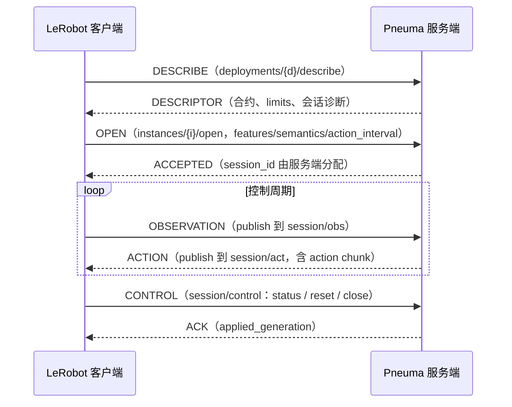

# 协议与支持范围

[返回 README](../README.md) · [运行与接入](usage.md) · [设计快照](../DESIGN.md)

Pneuma 实现 LeRobot **remote-inference v1** 协议（Zenoh + MessagePack），通过官方
`RemoteClient` 接收观测并返回动作块。

协议事实对齐 LeRobot main @ `f9e9d739e`（2026-10-22）：`src/lerobot/remote_inference/`
与 `src/lerobot/inference/contracts.py`。边界与路线决策见 [DESIGN.md](../DESIGN.md)（开发期可推翻快照）。

## 会话消息流

## 通道布局

所有 key 在 `lerobot/inference/v1/deployments/{deployment}` 之下：

| key 后缀 | 方向 | 说明 |
|---|---|---|
| `/describe` | queryable | 描述符查询（deployment 级） |
| `instances/{i}/open` | queryable | 独占准入；成功后服务端生成 session_id |
| `instances/{i}/alive` | liveliness token | 服务端启动代在场 |
| `sessions/{s}/alive` | liveliness token | 客户端会话在场（服务端 history 订阅） |
| `sessions/{s}/control` | queryable | status / reset / close |
| `sessions/{s}/obs` → `/act` | sub → pub | 观测进、动作块出 |

## 会话清理

对齐 LeRobot 的 `SessionWorker`：清理只由单泵执行，未完成的推理不会被新会话接管。

1. 服务端在 OPEN 时订阅 `sessions/{s}/alive`，并记录初始在场宽限起点。
2. 客户端在场令牌消失后，会话进入缺席宽限，时长取 `execution.idle_timeout_s`。
3. 宽限到期或收到 `close` 后，会话标记 `closing`；新 OPEN 回 `BUSY`，
   `details.admission_blocker` 为 `unfinished_inference` 或 `worker_cleanup_pending`。
4. 若有在途推理，服务端等它结束，丢弃其结果，再回 `close` 的 ACK 并释放所有权。
5. 没有在途推理时，`close` 立即回 ACK；宽限到期直接释放。

描述符的 `session.client_present`、`absence_grace_remaining_s`、`cleanup_pending`、
`cleanup_reason`、`admission_blocker` 和 `session_status` 反映上述状态。
