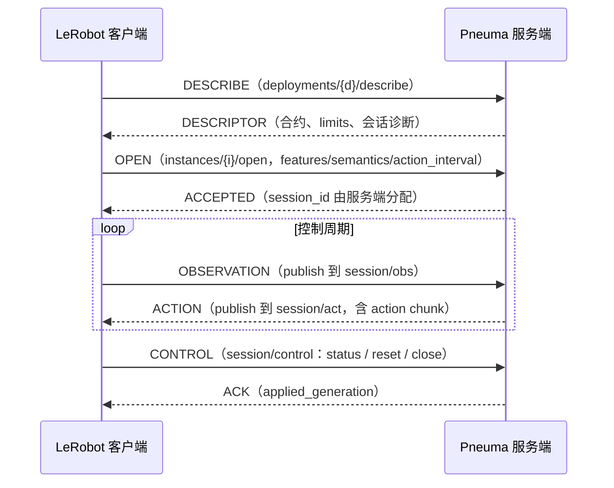

# 协议与支持范围

[返回 README](../README.md) · [运行与接入](usage.md) · [设计快照](../DESIGN.md)

Pneuma 实现 LeRobot **remote-inference v1** 协议（Zenoh + MessagePack），通过官方
`RemoteClient` 接收观测并返回动作块。ACT 后端用 Burn 执行 ResNet18 与 Transformer，
直接加载本地 safetensors checkpoint，提供 Flex CPU 和 Metal GPU 推理。
`model.policy=echo` 返回全零动作块，用于协议与会话冒烟；策略扩展边界是 `policy::PolicyRunner`。

协议事实对齐 LeRobot main @ `f9e9d739e`（2026-10-22）：`src/lerobot/remote_inference/`
与 `src/lerobot/inference/contracts.py`。边界与路线决策见 [DESIGN.md](../DESIGN.md)（开发期可推翻快照）。

## 会话消息流

## 通道布局

所有 key 在 `lerobot/inference/v1/deployments/{deployment}` 之下：

| key 后缀 | 方向 | 说明 |
|---|---|---|
| `/describe` | queryable | 描述符查询（deployment 级） |
| `instances/{i}/open` | queryable | 独占准入；成功后服务端生成 session_id |
| `instances/{i}/alive` | liveliness token | 服务端启动代在场 |
| `sessions/{s}/control` | queryable | status / reset / close |
| `sessions/{s}/obs` → `/act` | sub → pub | 观测进、动作块出 |

## 支持范围

已实现：describe/open 独占准入（semantics、mode、action_interval、features、raw encoding、
append chunk_settings）、观测逐特征合约校验、Burn ACT / SmolVLA plain chunk 推理，以及 status/reset/close
会话控制。DESCRIBE 报告当前 owner 和可用状态；观测必须匹配实例、会话和当前 generation。
RGB 与 tensor 均使用 raw 记录，JPEG 在准入时拒绝。SmolVLA 将观测中的 `task` 用于语言条件，
与独立 `language/request` 生成接口分开；任务随动作身份字段原样返回。

会话状态由单个 pump 持有，同步推理在一个阻塞任务中执行。入口有界，运行中的推理占用全实例唯一名额；
忙时返回 Busy，超量消息在回复名额或入口已满时丢弃。reset/close 可以在推理期间推进，旧任务结束前不启动
第二次推理；完成时已失效的 session/generation 结果会被丢弃。ACTION 分别报告真实排队与推理耗时。

未实现（入口处显式返回协议错误或未声明通道，不静默）：
aligned chunk merge、RTC/blending、独立语言生成（`capabilities.language=false`，通道已按客户端准入要求声明，
请求一律回 UNSUPPORTED）、客户端 liveliness 与缺席宽限。

## 实现索引

| 路径 | 职责 |
|---|---|
| [protocol.rs](../src/protocol.rs) | 线协议契约：寻址、信封、FeatureSpec/Capabilities |
| [codec.rs](../src/codec.rs) | 有界 MessagePack：拒绝 ext/NaN/重复键，tensor/rgb typed record |
| [server.rs](../src/server.rs) | Zenoh IO 泵与单会话状态机 |
| [policy/mod.rs](../src/policy/mod.rs) | 策略选择与 `PolicyRunner` 边界；`ZeroActionPolicy` 提供全零冒烟动作 |
| [policy/act/](../src/policy/act/) | ACT 模型、checkpoint 加载、特征约束、归一化及 Burn 前向推理 |
| [policy/smolvla/](../src/policy/smolvla/) | SmolVLA 视觉/文本/动作专家、tokenizer、processor 和 flow matching |
| [cli.rs](../src/cli.rs) | clap derive 分组参数和常用启动选项覆盖 |
| [config.rs](../src/config.rs) | `ServerConfig` 读取 TOML 与最终配置校验 |
